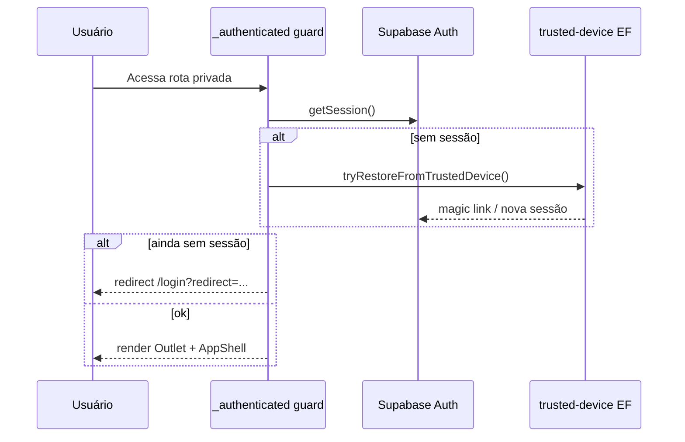

# Fluxos críticos

## 1. Bootstrap e navegação

1. `src/main.tsx` monta `QueryClientProvider` + `RouterProvider` com `routeTree.gen.ts`.
2. `__root.tsx` envolve com `AuthProvider` e providers M2A/progresso.
3. `/` (`index.tsx`) aguarda `useAuth().loading` e redireciona para `/dashboard` ou `/login`.

## 2. Autenticação e sessão

- **Login:** `routes/login.tsx` — `supabase.auth.signInWithPassword` (e fluxos relacionados no mesmo arquivo).
- **Roles:** `useAuth` busca `user_roles` após `onAuthStateChange`; invalida `queryClient` em SIGNED_IN/OUT/TOKEN_REFRESHED.
- **Dispositivo confiável:** `lib/trusted-device.ts` ↔ edge `trusted-device` (`issue`, `validate`, `revoke`).

## 3. Leitura/escrita de dados (padrão)

1. Hook em `features/*/hooks` define `useQuery` / `useMutation` com `supabase.from(...)` ou `.rpc(...)`.
2. Erros não silenciosos propagam para `handleGlobalError` (toast global), salvo `meta.silent`.
3. Mutations relevantes chamam `logAudit` (`lib/audit.ts`) onde implementado.

## 4. Sincronizar processo M2A → Planeja

1. Usuário informa URL/ID processo M2A (UI processo).
2. `fetchProcessoFromWorker` (`lib/m2a/worker.ts`) invoca `m2a-proxy` com `POST /processos/sync`.
3. Worker (`vps-worker/src/routes/processos.js`) busca dados no portal, retorna payload (`M2aSyncPayload`).
4. Hooks (`useSincronizarProcessoM2A`, `useProcessoForm`) persistem `processos`, `m2a_atas`, `m2a_itens`, `contratos`, snapshots — conforme lógica do hook (detalhe de merge não re-lido linha a linha neste índice).

## 5. Envio de contrato ao portal M2A

1. UI monta payload via `buildM2AContractPayload` (`lib/m2a/payload.ts`) + dados form (`useContratoForm`).
2. `sendToM2A` abre SSE via proxy → `POST /contratos/processar`.
3. Worker emite eventos de etapa; client reemite `CustomEvent` `M2A_PROGRESS` na `window`.
4. Componentes escutam progresso (`listenM2AProgress`, trackers globais).
5. Sucesso atualiza IDs M2A em `contratos` / documentos (`m2a_documento_id`, etc.) via callbacks das mutations (ver hooks `useEnviarContratoM2A`).

**Cancelamento:** função retornada por `sendToM2A` aborta `AbortController`, worker detecta fechamento SSE.

## 6. Importação de contratos (planilha)

1. Upload na rota `/importar-contratos`.
2. `parseContratoXlsx` / `agruparContratos` (`lib/contratoImport.ts`) no client.
3. Persistência em `contrato_import_jobs`, itens e dotações.
4. Validação pré-geração (`useValidacaoPreGeracao`) cruza dados M2A (atas, fornecedor).
5. Autorização gera registros em `contratos` (`useAutorizarGeracao`).

## 7. Fluxo IRP

1. Upload planilha → `analisar()` (`lib/irp.ts`).
2. Job salvo em `irp_jobs` + secretarias/unidades associadas.
3. Export por secretária (`gerarPlanilhaSecretaria`).
4. Envio ao M2A: `criarProcessoSrpM2A` ou fluxo comum conforme tipo; progresso via listeners em `client.ts`.

## 8. Numeração de contratos

- **Local (Postgres):** RPC `next_contrato_number*`, `lib/contrato-numbering.ts` — sequência por secretária/base.
- **Portal:** página `/numeracao` + `requestNumeracaoSync` ↔ worker `GET /numeracao` + persistência em tabela `numeracao`.

## 9. Relatórios e pauta consolidada

- RPC `get_pauta_consolidada_data` / `get_contract_report_data` (Postgres).
- Formatação Excel: `lib/excel-export.ts`; UI em `PautaConsolidadaExporter`, `ContractReportGenerator`.

## 10. Export / backup sistema

- Client `lib/system-export.ts` chama edge `system-export` por grupo de tabelas.
- Usuário ou cron (header `x-cron-secret`) monta ZIP no client.
- Paralelo offline: `database/*.json` + `tools/sync-database-from-backup.mjs`.

## 11. Download documentos M2A

`useDownloadDocumentos` → `downloadM2ADocuments` → proxy → worker `/documentos/baixar` ou stream + polling arquivo.

## 12. Auditoria

- Tabela `audit_logs`; UI `/logs`.
- Função `logAudit` para eventos aplicacionais.

## Integrações externas

| Sistema | Interface |
|---------|-----------|
| Supabase | HTTPS + anon key (RLS) |
| Portal M2A | Somente via VPS worker (sessão M2A no worker) |
| VPS worker | HTTPS assinado via `m2a-proxy` |
