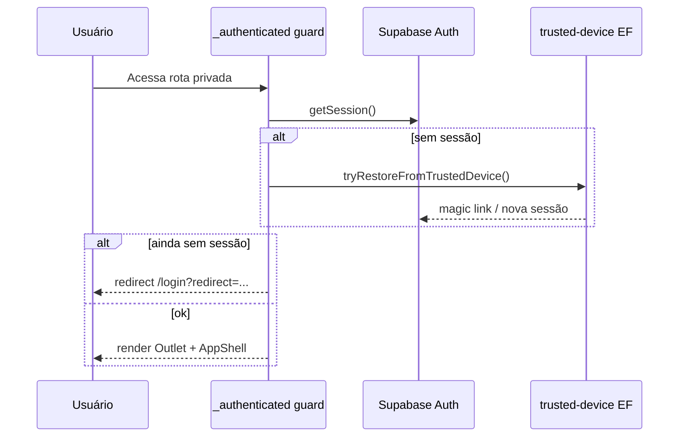

# Fluxos críticos

## 1. Bootstrap e navegação

1. `src/main.tsx` monta `QueryClientProvider` + `RouterProvider` com `routeTree.gen.ts`.
2. `__root.tsx` envolve com `AuthProvider` e providers M2A/progresso.
3. `/` (`index.tsx`) aguarda `useAuth().loading` e redireciona para `/dashboard` ou `/login`.

## 2. Autenticação e sessão

- **Login:** `routes/login.tsx` — `supabase.auth.signInWithPassword` (e fluxos relacionados no mesmo arquivo).
- **Roles:** `useAuth` busca `user_roles` após `onAuthStateChange`; invalida `queryClient` em SIGNED_IN/USER_UPDATED; TOKEN_REFRESHED não refetch a lista inteira.
- **Dispositivo confiável:** `lib/trusted-device.ts` ↔ edge `trusted-device` (`issue`, `validate`, `revoke`).

## 3. Leitura/escrita de dados (padrão)

1. Hook em `features/*/hooks` define `useQuery` / `useMutation` com `supabase.from(...)` ou `.rpc(...)`.
2. Erros não silenciosos propagam para `handleGlobalError` (toast global), salvo `meta.silent`.
3. Mutations relevantes chamam `logAudit` (`lib/audit.ts`) onde implementado.

## 4. Sincronizar processo M2A → Planeja

1. Usuário informa URL/ID processo M2A (UI processo).
2. `fetchProcessoFromWorker` (`lib/m2a/worker.ts`) invoca `m2a-proxy` com `POST /processos/sync`.
3. Worker (`vps-worker/src/routes/processos.js`) busca dados no portal, retorna payload (`M2aSyncPayload`).
4. Hooks (`useSincronizarProcessoM2A`, `useProcessoForm`) persistem `processos`, `m2a_atas`, `m2a_itens`, `contratos`, snapshots — conforme lógica do hook (detalhe de merge não re-lido linha a linha neste índice).

## 5. Envio de contrato ao portal M2A

1. UI monta payload via `buildM2AContractPayload` (`lib/m2a/payload.ts`) + dados form (`useContratoForm`).
2. `sendToM2A` abre SSE via proxy → `POST /contratos/processar` (`readSseStream` em `lib/m2a/sse.ts`, também usado por SRP/comum/documentos).
3. Worker emite eventos de etapa; client reemite `CustomEvent` `M2A_PROGRESS` na `window`.
4. Componentes escutam progresso (`listenM2AProgress`, trackers globais).
5. Sucesso atualiza IDs M2A em `contratos` / documentos (`m2a_documento_id`, etc.) via callbacks das mutations (ver hooks `useEnviarContratoM2A`).

**Cancelamento:** função retornada por `sendToM2A` aborta `AbortController`, worker detecta fechamento SSE.

## 6. Importação de contratos (planilha)

1. Upload na rota `/importar-contratos` (aberta por **Novo contrato** em `/contratos`; o cadastro manual fica em “⋯ → Cadastro manual”).
2. `parseContratoXlsx` / `agruparContratos` (`lib/contratoImport.ts`) no client; XLSX lido via Web Worker (`readXlsxMatrix`).
3. Persistência em `contrato_import_jobs`, itens e dotações.
4. Validação pré-geração (`useValidacaoPreGeracao`) cruza dados M2A (atas, fornecedor).
5. Autorização gera registros em `contratos` (`useAutorizarGeracao`).

## 7. Fluxo IRP

1. **Novo processo** em `/processos` abre `/irp`. Upload planilha → `analisar()` (`lib/irp.ts`); leitura XLSX no Web Worker. O histórico de importações fica na lateral de `/irp`; o detalhe do processo tem “Abrir importação IRP” (`irp_jobs.processo_id`).
2. Job salvo em `irp_jobs` + secretarias/unidades associadas.
3. Export por secretária (`gerarPlanilhaSecretaria`).
4. Envio ao M2A: `criarProcessoSrpM2A` ou fluxo comum conforme tipo; progresso via listeners em `client.ts`.
5. IRP no portal, em fases (`orquestrador-processo-srp.js`): gera intenções na DFD nova (se o portal recusar e a tabela já tiver linhas, segue); lista intenções, lê órgão+UO em `atualizar/{id}/?detail=true`, disponibiliza com `data_aviso` (1 dia útil após a DFD) e `data_consolidacao` (8 dias úteis depois), manifesta todas, preenche quantidades item a item, finaliza e consolida. A tela lê a coluna de cada dotação. A gerenciadora é a coluna escolhida no cabeçalho (`gerenciadora_chave`); DFD e quantitativos usam essa coluna, sem cair na primeira da lista. A DFD e a IRP de FUNDEB, FMS e FUNDO leem a coluna de soma (AE, AO, AX; UO `12904` / `12906` / `12909`), uma vez. Se a unidade de fornecimento da planilha não existir no catálogo do item, o worker cria com o nome completo (`POST /catalogo/unidadefornecimento/incluir/`) e usa o id retornado. Apuração por lote (`criterio_apuracao=2`) cria os lotes vazios logo após atualizar o processo (aborta se o processo já tiver item) com o texto da coluna LOTE, ou `LOTE N` quando a célula só tem o número; só depois da justificativa vincula os itens, com um CSRF da página do processo. Reordenar itens (`alterar_sequencial`) é opcional e vem desligado: ligado, o M2A empurra os lotes para depois dos itens. O SSE do SRP envia heartbeat a cada 15s; se o stream fechar sem `done`, o Planeja libera a tela. POST com sessão expirada não reenvia o body: o cliente faz login e devolve `M2A_CSRF_STALE`; o caller busca CSRF de novo e repete o POST uma vez. HTTP 400 na consolidação é rejeição do portal (o corpo é registrado) e o lote segue para a próxima intenção.

## 8. Numeração de contratos

- **Local (Postgres):** RPC `next_contrato_number*`, `lib/contrato-numbering.ts` — sequência por secretária/base.
- **Portal:** a página `/numeracao` foi removida. `requestNumeracaoSync` (`lib/m2a/client.ts`) e o worker `GET /numeracao` permanecem sem tela. A tabela `numeracao` continua usada por `contratos.tsx`, `useAutorizarGeracao.ts` e pelas RPC `next_contrato_number*`.

## 9. Relatórios e pauta consolidada

- RPC `get_pauta_consolidada_data` / `get_contract_report_data` (Postgres).
- Formatação Excel: `lib/excel-export.ts`; UI em `PautaConsolidadaExporter`, `ContractReportGenerator`.

## 10. Export / backup sistema

- Client `lib/system-export.ts` chama edge `system-export` por grupo de tabelas.
- Usuário ou cron (header `x-cron-secret`) monta ZIP no client.
- Paralelo offline: `database/*.json` + `tools/sync-database-from-backup.mjs`.

## 11. Download documentos M2A

`useDownloadDocumentos` → `downloadM2ADocuments` → proxy → worker `/documentos/baixar` ou stream + polling arquivo.

## 12. Auditoria

- Tabela `audit_logs`; UI `/logs`.
- Função `logAudit` para eventos aplicacionais.
- A rota `/historico` (Jobs IRP) foi removida; `irp_jobs` segue acessível por `/irp?job=`.

## 13. Tarefas (Kanban)

- `/tarefas`: `useEtapas/useCampos/useTarefas` (React Query; refetch ao focar + a cada 60s). Quadro `@dnd-kit` (mouse, toque e teclado; arraste pela alça). Movimento otimista com rollback (`useMoverTarefa`); ordem por `posicao` fracionária (`posicaoEntre`, renumeração da coluna se o intervalo < 1e-6).
- Edição no painel lateral (`TarefaSheet`) com checagem de conflito por `updated_at` (`ConflitoTarefaError`). Triggers gravam `tarefa_eventos` (criada, movida, situação, responsável, excluída) e `etapa_desde`.
- Campos por etapa (`tarefa_campos`; valores em `tarefas.campos` por id do campo; `usa_como_fase` destaca no card e no relatório). Etapa só é excluída se vazia; arquivar também exige coluna vazia.
- Links só `http/https` (`urlSegura`, `rel="noopener noreferrer"`). Anexos: bucket `tarefas-files`, até 25 MB, URL assinada de 60s.
- Filtros (`FiltrosBar`): busca com debounce (título, número e objeto do processo) + modalidade, tipo, secretaria, responsável e situação; critérios ativos viram chips removíveis e são repassados ao relatório.
- Relatório (`relatorio.ts`, `RelatorioMenu`): imprimir (A4), PDF (`jspdf-autotable`), Excel (`exceljs`) e texto para WhatsApp, agrupados por etapa, respeitando filtros; libs carregadas sob demanda. Indicadores: total, em andamento, concluídas (etapas com `finaliza`), em atenção e travadas — não há conceito de prazo/atraso. Cabeçalho institucional só com `VITE_RELATORIO_*` configuradas.
- Backup/restore: grupo `tarefas` em `system-export` e `tools/import-database.mjs`.

## 14. Meu perfil

- `/perfil`: `profiles` (nome, telefone, cargo, endereço) + `profile_secretarias`. Trigger `profiles_protect_sensitive_columns` impede não-admin de alterar `ativo`/`email`. Troca de senha envia e-mail pelo fluxo `/reset-password`. O bloco do usuário no menu mostra o nome e leva a `/perfil`.

## Integrações externas

| Sistema | Interface |
|---------|-----------|
| Supabase | HTTPS + anon key (RLS) |
| Portal M2A | Somente via VPS worker (sessão M2A no worker) |
| VPS worker | HTTPS assinado via `m2a-proxy` |
