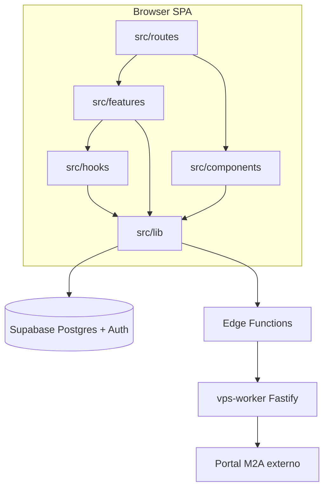

# Dependências entre módulos

## Grafo lógico (runtime web)

## Alias de import

- `@/*` → `src/*` (`tsconfig.json`, `vite-tsconfig-paths`).

## Camadas e dependências permitidas (observado)

| De | Para | Exemplos |
|----|------|----------|
| `routes/*` | `features/*`, `components/*`, `hooks/*`, `lib/*`, `@/integrations/supabase/client` | Páginas finas; lógica em features |
| `features/*` | `lib/*`, `hooks/*`, `components/*`, supabase | Sem import cruzado forte entre features (cada vertical isolada) |
| `lib/m2a/*` | `integrations/supabase/client`, eventos window (`M2A_PROGRESS`) | Front **nunca** chama VPS direto |
| `lib/*` (geral) | supabase, utils | `audit`, numbering, import parsers |
| `components/ui/*` | Radix, tailwind | Sem supabase |
| `vps-worker/*` | `m2a-client`, módulos `m2a/` | Independente do bundle Vite |

## Integração Supabase (front)

~50 arquivos importam `@/integrations/supabase/client` (queries/mutations diretas ou RPC). Tipos em `Database` guiam tabelas e funções.

**Papéis:** `useAuth` lê `user_roles`; guards de rota usam sessão, não roles (autorização fina pode estar em RLS/UI).

## Integração M2A

1. **Sync processo:** `lib/m2a/worker.ts` → `supabase.functions.invoke('m2a-proxy')` → VPS `POST /processos/sync` → persiste via hooks (`useSincronizarProcessoM2A`, `useProcessoForm`).
2. **Envio contrato:** `lib/m2a/client.ts` `sendToM2A` → proxy SSE → VPS `POST /contratos/processar` → eventos `M2A_PROGRESS` na window → UI (`EnvioM2ASection`, progress trackers).
3. **Documentos:** `lib/m2a/documents.ts` → proxy → `/documentos/baixar*` no worker.
4. **Numeração:** `requestNumeracaoSync` / rota `/numeracao` UI → worker `GET /numeracao`.
5. **Atas:** `lib/m2a/atas.ts` → proxy → rotas `/atas/...`.
6. **Criação processo IRP:** `lib/m2a/srp.ts`, `comum.ts` → proxy → `/processos/srp/criar`, `/processos/comum/criar`.

**Autenticação proxy → worker:** Edge assina corpo com secret compartilhado; worker valida em `authPlugin` (`X-Signature`, `X-Timestamp`).

## TanStack Query

- Singleton `queryClient` exportado de `lib/query-client.ts`.
- Usado em `main.tsx`, `__root.tsx` (contexto router), `useAuth` (invalidate on auth events).
- Features definem query keys localmente nos hooks (padrão por feature).

## TanStack Router

- File routes em `src/routes/`.
- Contexto router inclui `queryClient`.
- Guard central: `_authenticated.tsx` → depende de `supabase.auth` + `trusted-device`.

## Edge functions — dependências

| Function | Depende de |
|----------|------------|
| `m2a-proxy` | Supabase JWT, env VPS URL + HMAC secret |
| `trusted-device` | `trusted_devices`, Auth admin API |
| `system-export` | Service role, grupos em `TABLE_GROUPS` |

## VPS worker — mapa rota → módulo

| Rota | Módulo principal |
|------|------------------|
| `GET /health` | — (público) |
| `POST /auth/refresh`, `GET /auth/status` | `m2a-client` |
| `GET /numeracao` | numeração portal |
| `POST /processos/sync`, `GET /processos/:id/...` | `routes/processos.js`, parsers atas |
| `POST /processos/srp/criar` | `orquestrador-processo-srp.js` |
| `POST /processos/comum/criar` | `orquestrador-processo-comum.js` |
| `POST /contratos/processar` (+ json, diagnosticar, sincronizar) | `orquestrador-contrato.js` |
| `POST /documentos/baixar*` | `routes/documentos.js` |
| `GET/POST /atas/:ataId/...` | `m2a/atas-*.js` |

## Pacotes npm (front) — acoplamento

| Pacote | Uso no projeto |
|--------|----------------|
| `@supabase/supabase-js` | Client, functions invoke |
| `@tanstack/react-query` | Estado servidor |
| `@tanstack/react-router` | Rotas |
| `exceljs`, `file-saver`, `jszip` | Import/export planilhas |
| `jspdf`, `jspdf-autotable` | PDFs |
| `@radix-ui/*`, `tailwindcss` | UI |
| `zod`, `@hookform/resolvers` | Validação forms |

## Dependências externas ignoradas na indexação

`node_modules/`, `dist/`, caches (`.cursorignore`), artefatos lockfile apenas como metadado de versão.

## `database/` backups

Não participam do bundle. Consumidos por `tools/sync-database-from-backup.mjs` e edge `system-export` (grupos espelham `database/groups/*.json`).
